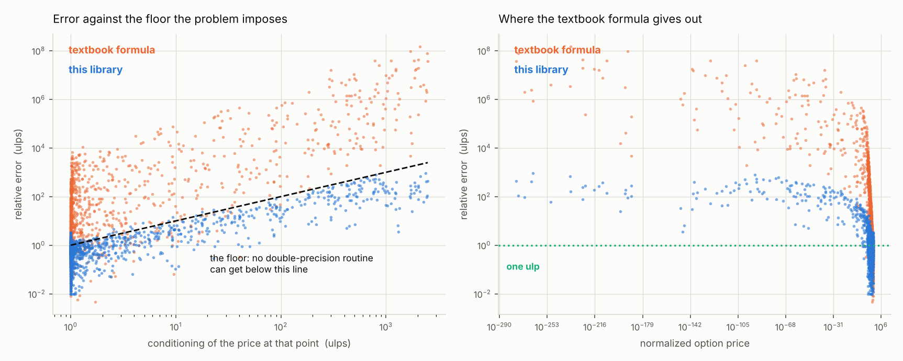
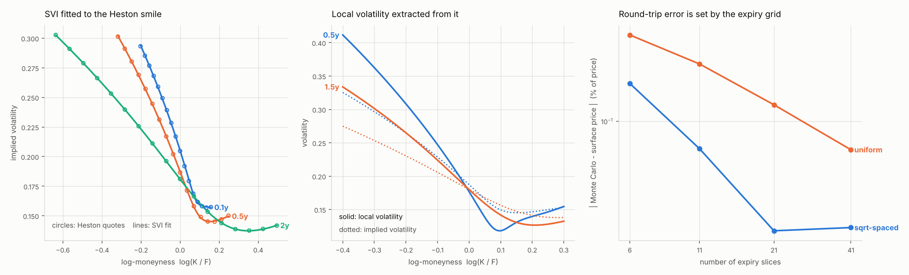

# `volsurf` — derivatives pricing and volatility surfaces

A volatility surface is the one object every equity derivatives desk shares.
It is built from a few hundred option quotes, it has to be free of arbitrage,
and everything downstream — exotics pricing, hedging, risk — is only as good as
it is.

This library builds one, from quotes to a simulatable local volatility surface,
and then closes the loop by simulating it and repricing the quotes it started
from. Three results are worth stating up front:

- **The Black formula is evaluated at the precision limit of the problem.**
  Measured against a 50-digit reference over 1245 points spanning the whole
  admissible domain: median error **0.8 ulps**, and every point within
  **3.3× its own conditioning floor** — the factor by which the price's
  sensitivity to an ulp of its own inputs bounds *any* double-precision
  routine. The textbook formula on the same points has a median of 19 ulps and
  a worst case of **1.5 × 10⁸**.
- **Implied volatility inverts to the same standard**, with a median relative
  error of exactly zero over 10,197 quotes and 4.2 Halley iterations on
  average — and it says so when a quote cannot support an answer, instead of
  returning a confident wrong number.
- **The full Dupire chain closes.** Heston → prices → implied vols → SVI →
  local volatility → Monte Carlo → prices, with the two error sources
  separated and each one driven to the level it should reach.

```bash
cd derivatives && pip install -e ".[dev,exact,plot]" && pytest tests/ -q
```

104 tests, 99% coverage.

---

## 1. The Black formula, at the precision limit



Deep out of the money, the textbook Black formula subtracts two nearly equal
numbers that are both close to underflow and keeps none of the digits. This is
not an exotic corner: a one-week option five percent out of the money is
already there, and short-dated wings are where index skew lives.

The fix came in four steps, each worth orders of magnitude:

1. **Reflect to out-of-the-money.** Put-call parity in normalized form means
   an in-the-money call can be priced as intrinsic value plus the matching
   out-of-the-money price, which is the well-conditioned one. Every evaluation
   then has `x ≤ 0`.

2. **Factor out the Gaussian, and never let it cancel.** Because
   `x = 2ht`, the factor `G = exp(-(h²+t²)/2)/√(2π)` is *common to both terms*
   of the formula. It carries the entire sensitivity of the price to its
   inputs — about `h²/2` ulps, which is irreducible — so the whole game is to
   keep it out of every subtraction rather than let it be amplified.

3. **Three forms, selected on measured cancellation.** What remains after
   factoring `G` out can be written three algebraically identical ways: the
   direct formula, a Mills-ratio difference, and a split form whose CDF gap is
   a 16-node Gauss–Legendre integral of the density. They fail in *different*
   corners — direct near the money at low volatility, Mills when `s` is small
   against `|d₁|`, split out in the wings. Each one reports its own
   cancellation, the sum of the magnitudes of its terms over their algebraic
   sum, and the least cancelling one wins.

   Deriving the crossovers analytically from the asymptotics of the Mills
   ratio was tried first and is **wrong by a factor of ten** in precisely the
   region that needs it. Measuring beats modelling here.

4. **Thread known gaps through; never recompute them.** `d₁ - d₂` is exactly
   `s`, but *recovering* it by subtracting the two stored values is a
   cancelling subtraction of two numbers near `0.38` that differ by `2.6e-4`.
   That one avoidable operation was costing three orders of magnitude.

The left panel is the real claim. Plotting error against *conditioning* rather
than against moneyness separates how hard a point is from how well the routine
handles it: points on the diagonal are optimal, points above it are losing
digits of their own. This library sits on the line.

**Reproduce:** `python experiments/precision.py`

## 2. Inverting it

Implied volatility is the market's actual quoting convention, so this runs
millions of times in a surface build and has to work on wing quotes worth
`1e-12`. Three decisions:

- **Split at the inflection point.** `b` is convex in `s` below
  `s* = √(2|x|)` and concave above it. Newton on the raw price is badly
  behaved in the convex region, so below `s*` the solve runs on `log b`, which
  is nearly linear there. This single change turns an unreliable solver into a
  four-iteration one.
- **Never leave the bracket.** A bracket is established before iterating and
  maintained throughout; any Halley step that escapes becomes a bisection. The
  solver converges for *every* admissible input, not for the ones that suit the
  initial guess.
- **Report what the input cannot support.** An in-the-money quote carries its
  volatility entirely in its time value, which has to be recovered by
  subtracting the intrinsic. A one-week call six volatilities in the money has
  a time value of `1e-100` against a price of order one — the float does not
  contain it. The solver reports how many ulps of the quote the recovered time
  value is worth and returns NaN below a floor, rather than inverting noise.

  That diagnostic is a genuine forecast, not a label: across quotes spanning
  five orders of magnitude of significance, the relative error tracks
  `1 / ulps`. The test suite asserts exactly that.

| | |
|---|---|
| quotes round-tripped | 10,197 |
| median relative error | **exactly 0** |
| worst case vs. conditioning floor | **3.6×** |
| mean Halley iterations | 4.2 |

## 3. SVI, calibrated as a function rather than a search

A market quotes maybe fifteen strikes per expiry; everything downstream needs a
smooth arbitrage-free curve through them. Gatheral's raw SVI gives one with
analytic derivatives, so the no-arbitrage conditions and the local volatility
in §4 are exact rather than finite-differenced.

The calibration is the interesting part. Throwing five correlated parameters at
a general optimiser lands in different local minima from different starting
points, which is not acceptable when the fit feeds a risk number. Instead, for
fixed `(m, σ)` the slice is **linear** in the other three:

```
w = a + d·y + c·√(y²+1),    y = (k-m)/σ,    d = ρbσ,  c = bσ
```

and the constraints `b ≥ 0`, `|ρ| ≤ 1` become `c ≥ 0`, `|d| ≤ c` — not box
constraints, so a bounded solver cannot be used directly. The substitution
`u = c+d`, `v = c-d` fixes that exactly: `|d| ≤ c` becomes `u, v ≥ 0`, and
Gatheral's no-butterfly bound becomes `u, v ≤ 4σ`. Every constraint is now a
simple bound, so the inner problem is an **exactly solvable bounded linear
least squares** — no iteration, no starting guess, no local minima. Only
`(m, σ)` is left to search, and two dimensions is small enough to multistart
properly.

The result is deterministic: the same quotes always give the same slice, and
planted parameters come back to five decimal places.

The fit is also checked where it matters. The Gatheral–Jacquier function
`g(k)` is the factor multiplying the Gaussian in the risk-neutral density, so a
negative `g` *is* a negative probability — and a plain least-squares SVI fit to
clean quotes violates it routinely in the wings. Here the bounds that make the
inner problem solvable are the no-arbitrage constraints, so they hold by
construction.

## 4. Local volatility, and why the two no-arbitrage conditions are the same two

Dupire's local variance, in terms of total implied variance `w(k,T)`:

```
σ_loc² = (∂w/∂T) / D,
D = 1 - (k/w)·w_k + ¼(-¼ - 1/w + k²/w²)·w_k² + ½·w_kk
```

Expanding both expressions shows that **`D` is identically the butterfly
function `g(k)`** — the same object whose non-negativity makes the density a
density, reached from a completely different direction (the forward PDE rather
than the price of a butterfly spread). So

```
σ_loc² = (∂w/∂T) / g(k)
```

and the only two ways this fails are the two classical arbitrages: a negative
denominator is butterfly arbitrage, a negative numerator is calendar arbitrage.
**Local volatility exists precisely when the surface is arbitrage-free.**

The two are computed by separate functions on purpose, so the identity can be
asserted rather than assumed; the suite checks it to `1e-14` over random
parameters. When either condition fails the surface returns NaN and says which
one — clipping to a small positive number would let a simulation run happily on
prices that admit arbitrage.

A sanity check that falls out: local volatility skew comes out at **2.14× to
2.45×** implied volatility skew, rising with maturity — the standard desk rule
of thumb, which a sign error in `D` breaks immediately.

## 5. Heston, three ways

The reference model, used here to generate a market that is exact,
arbitrage-free and genuinely curved.

Two things are easy to get wrong, and both are tested directly. The **branch
cut**: the textbook arrangement of the characteristic function crosses the
principal branch cut of the complex logarithm at long maturities, and the
symptom is prices that are correct for a year and oscillate at ten. The
Albrecher "Little Trap" arrangement keeps `|g| < 1` throughout. The
**martingale identity** `φ(-i) = 1` holds to `1e-11` out to thirty years, which
is where the naive form has visibly broken.

| route | what it is | agreement |
|---|---|---|
| `price` | Lewis integral, adaptive quadrature | reference |
| `price_fft` | Carr–Madan, 4096 strikes in 1.3 ms | `1e-12` absolute |
| `simulate` | full-truncation Euler Monte Carlo | within 0.8σ |

The Monte Carlo is the one that counts: the quadrature and the FFT are two
rearrangements of the same algebra and would agree with each other even if the
characteristic function were wrong.

One finding worth recording. Carr and Madan specify Simpson weights for the
FFT, and most implementations follow them. Measured against the quadrature,
**Simpson is worse than plain trapezoid by seven orders of magnitude** —
`4.8e-5` relative against `5.9e-12`. The reason is the exponentially convergent
trapezoidal rule: on an equispaced grid, Euler–Maclaurin expresses the
trapezoid error entirely in endpoint derivatives, and for an analytic integrand
decaying to nothing at the cutoff every one of those terms vanishes.
Convergence is geometric, and Simpson's fourth-order error term is strictly a
downgrade.

## 6. The round trip



Dupire's construction claims the surface determines a unique diffusion that
reprices every European option on it. That is testable, but only if the test
is genuinely closed:

```
Heston → prices → implied vols → SVI fit → surface
       → Dupire local volatility → Monte Carlo → prices again
```

Every arrow is a different module, and the last one shares no algebra with the
others — a Monte Carlo of the local volatility SDE cannot agree with the
surface by construction the way two Fourier rearrangements can. Heston stands
in for a market because it gives an exact, arbitrage-free, genuinely *curved*
smile at every expiry, so the fit has something real to miss.

The run reports two error sources separately, because they have different
causes and different cures:

| | at 0.5y ATM |
|---|---|
| **fit error** — SVI vs. the Heston smile | `4.4e-4` volatility points (RMSE), worst `1.2e-3` at the short end |
| **round-trip error** — Monte Carlo vs. the price the fitted surface implies | see below |

The round-trip error is the one that tests Dupire, and on a market-like expiry
grid it starts at **−1.6%** — far too large to be Monte Carlo noise. It is not
Dupire, the fit, or the simulation. It is the piecewise-linear interpolation of
total variance between expiry slices: `∂w/∂T` is the numerator of the local
variance, and interpolating linearly makes it a *chord* slope where Heston's
`w(T)` is curved.

Refining the expiry grid drives it to zero, and *where* you refine matters more
than how much:

| slices | uniform spacing | √-spacing |
|---|---|---|
| 6 | −0.485% | −0.200% |
| 11 | −0.285% | −0.061% |
| 21 | −0.135% | −0.013% |
| 41 | −0.059% | **+0.014%** (0.3σ) |

Uniform spacing converges as `O(1/n)` — the error halves each time the slice
count doubles. Concentrating the slices at the short end, where `w(T)` is most
curved, reaches Monte Carlo noise at 21 slices and beats the 41-slice uniform
grid with half as many. For anyone building a surface from real quotes, that
is the practical finding: the short end of the expiry grid is where the
resolution has to go.

The Monte Carlo itself uses antithetic sampling and a control variate — the
same option under GBM driven by the *same* increments, with the regression
coefficient estimated rather than assumed — for an 18× variance reduction, and
the Euler bias is measured separately by halving the step size rather than
assumed away.

**Reproduce:** `python experiments/round_trip.py` (a few minutes)

---

## Layout

```
src/volsurf/
  normal.py     Mills ratios and the de-cancelled difference everything rests on
  black.py      the Black formula and twelve Greeks, all finite-difference tested
  implied.py    the inverse, with conditioning and significance reported
  svi.py        SVI, with an exactly solvable inner calibration
  surface.py    slices → surface → Dupire local volatility
  heston.py     characteristic function, Lewis quadrature, Carr–Madan FFT, MC
  mc.py         local-volatility Monte Carlo with measured variance reduction
tests/          104 tests, 99% coverage
experiments/    the two figures above, reproducible end to end
```

## On correctness

Every number in this README is measured by a script in `experiments/` or
asserted by a test, and the references are deliberately independent of the code
they check:

- **Arbitrary precision.** `mpmath` at 50 digits evaluates the Black formula
  straight from the definition — no rearrangement, because at 50 digits none is
  needed. That is what makes it independent of the double-precision work.
- **Conditioning.** The error floor is computed in closed form at each point
  rather than guessed, so the accuracy claim is "at the limit" rather than
  "small".
- **Cross-module.** The SVI risk-neutral density is checked against the second
  derivative of actual Black prices; the Dupire denominator against the
  butterfly function; the Heston characteristic function against a Monte Carlo
  that shares none of its algebra.
- **Finite differences.** All twelve Greeks, across four parameter sets and
  both option types. This caught a genuine error: `charm` was written with `q`
  where `∂d₁/∂T` requires the net carry `r − q`, an error of `S·Γ·(r − 2q)`
  that is small enough to look plausible and that no reference-value check
  would have found.

Three things were measured and turned out to contradict the obvious choice,
and all three are documented where they were found rather than quietly fixed:
analytic crossover thresholds for the Black evaluation forms (wrong by 10×),
Simpson weights in the Carr–Madan FFT (worse than trapezoid by 10⁷), and the
assumption that the round-trip error was a Monte Carlo bias (it was the expiry
grid).

## License

MIT
